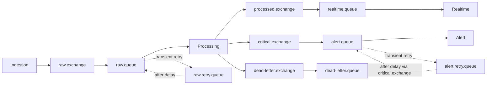
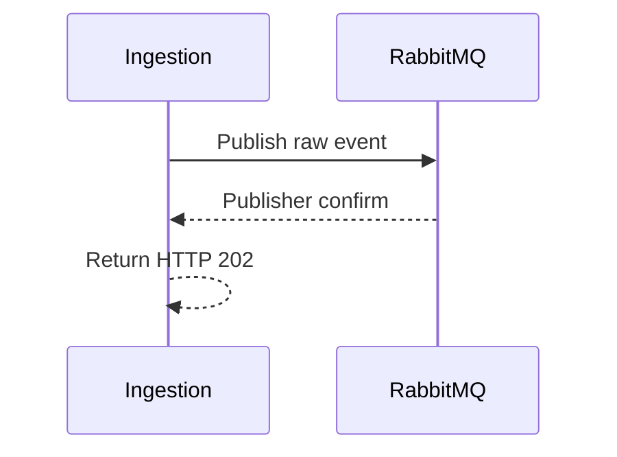
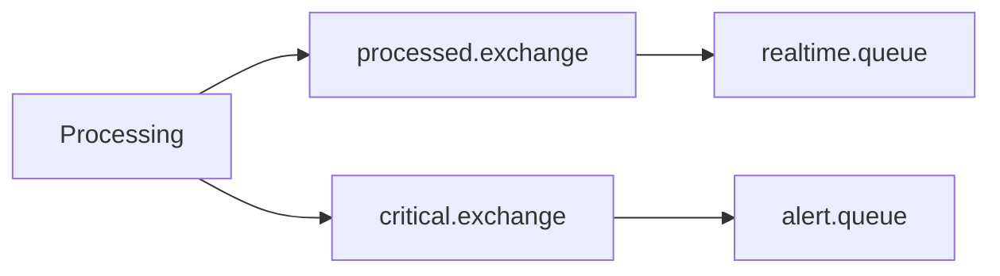

# RabbitMQ Topology

## 1. Topology

RabbitMQ provides ingestion buffering, asynchronous delivery, retry, and dead-letter handling.



## 2. Exchanges and Queues

| Exchange | Queue | Consumer / Purpose |
|---|---|---|
| `raw.exchange` | `raw.queue` | Processing |
| `processed.exchange` | `realtime.queue` | Realtime |
| `critical.exchange` | `alert.queue` | Alert |
| `dead-letter.exchange` | `dead-letter.queue` | permanently failed message inspection |

`raw.retry.queue` provides delayed retry for transient processing failures. `alert.retry.queue` provides the equivalent delayed retry path for `alert.queue`, returning through `critical.exchange` with routing key `critical.log`. Both retry queues are durable and transfers preserve the original envelope/payload and `event_id`.

Suggested routing keys:

```text
raw.log
processed.log
critical.log
dead-letter.log
```

Exact payloads and bindings belong in the event contract/configuration.

## 3. Publisher and ACK Semantics

### Ingestion



Use durable exchanges/queues and persistent messages. Return ingestion success only after publisher confirmation and successful routing to `raw.queue`; unroutable publications fail ingestion. Retry/DLQ transfers require confirmed routing before ACKing the original message.

### Processing

A raw message is ACKed only after its required durable work for that processing attempt is safely accounted for: ClickHouse persistence and required processed/critical publication. Failures enter the retry/DLQ policy instead of being silently ACKed.

### Alert

Successful Alert ACK follows [Failure Handling](failure-handling.md#alert-accounting-and-redelivery), independently of Telegram/SSE delivery. Failed attempts use confirmed retry/DLQ transfer before ACKing their original delivery.

## 4. At-Least-Once

Redelivery and duplicate processing are expected.

Mitigation:
- stable `event_id`;
- idempotent processing where required;
- Redis atomic alert deduplication;
- PostgreSQL Incident fingerprint/state constraints.

## 5. Retry and DLQ

Suggested configurable retry schedule:

```text
5 seconds -> 30 seconds -> 2 minutes
```

Permanent validation failures go directly to DLQ. Transient failures are retried; after the configured retry policy is exhausted, the message must remain explicitly accounted for rather than silently dropped.

For `alert.queue`, transient Redis/PostgreSQL/consumer failures use `alert.retry.queue` with the same suggested delays and the retry bound defined in [Configuration](../operations/configuration.md#6-alerting). Permanently unprocessable critical events go directly to `dead-letter.exchange` / `dead-letter.queue`; exhausted transient attempts go there with reason `ALERT_RETRY_EXHAUSTED`. Preserve the original critical envelope in the DLQ payload's `original_message` for inspection/recovery. Missing/disabled rules are accounted no-ops, not permanent errors. If retry/DLQ routing or confirmation fails, do not ACK the original; retain it for broker redelivery.

The original message is considered handled only after successful retry/DLQ accounting.

### Processing retry implementation

`PROCESSING_RETRY_MAX_ATTEMPTS=3` means three retries after the initial attempt. The integer AMQP header `x-processing-retry-count` is zero when absent; retry copies carry counts 1, 2 and 3 with per-message expiration delays of `5s`, `30s` and `120s` by default. Delays are configurable minimum waits: messages expire at the head of the single retry queue, so a shorter delay can wait behind a longer one. Do not use `redelivered` or broker `x-death` as this counter. Malformed, negative or out-of-range counters go to whole-batch DLQ with `INVALID_RETRY_METADATA`; failure at the retry bound uses `PROCESSING_RETRY_EXHAUSTED`.

Publish persistent, mandatory retry copies through the existing default exchange (`""`) with routing key `raw.retry.queue`, preserving the exact raw body and original message ID. Declare this durable queue as quorum with `x-dead-letter-strategy=at-least-once`, `x-overflow=reject-publish`, `x-dead-letter-exchange=raw.exchange` and `x-dead-letter-routing-key=raw.log`. RabbitMQ 4.2 prerequisites, including the `stream_queue` feature flag and compatible queue arguments/policies, must be verified before activation. An incompatible existing queue must not be deleted or migrated by the application. Keep existing raw/downstream bindings unchanged. These settings retain expired messages until forwarding is confirmed; default at-most-once dead-letter forwarding is insufficient for this handoff. See [RabbitMQ quorum dead-lettering](https://www.rabbitmq.com/docs/4.2/quorum-queues#dead-lettering).

Whole invalid batches go directly to `dead-letter.exchange` / `dead-letter.log`; the durable queue is `dead-letter.queue`. Retry/DLQ publication needs an ACK without a mandatory return before the source delivery becomes ACK-ready. If transfer is unconfirmed, keep the source unacknowledged for the first configured retry delay (5s when retries are disabled), then requeue individually. A separate timer prevents synchronous publication from starving this cooldown. Uncertain transfers can duplicate both copies; there is no exactly-once or global physical-attempt bound.

### Alert retry implementation

Declare/provision separately exactly one durable, non-exclusive, non-auto-delete
queue alert.retry.queue with arguments:

```json
{"x-queue-type":"quorum","x-dead-letter-strategy":"at-least-once","x-overflow":"reject-publish","x-dead-letter-exchange":"critical.exchange","x-dead-letter-routing-key":"critical.log"}
```

No new exchange or explicit retry binding is required: publish mandatory to the
existing default exchange with routing key alert.retry.queue. Existing durable
critical.exchange / critical.log -> alert.queue routing must already be verified.
Per-message expiration implements minimum delays5s/30s/120s; head-of-line expiry
in a single retry queue may increase waits. Require compatible RabbitMQ4.2 quorum
dead-lettering prerequisites, stream_queue flag and effective policies/arguments.
Never delete/migrate an incompatible queue automatically. Positive retry publication
confirmation alone does not prove safe later dead-letter forwarding.

Alert startup does not auto-declare topology. Operator preflight must verify full
queue arguments, target bindings, permissions, feature flags and actual message-size
ceiling; runtime passive existence checks do not prove these properties. Failure
retains source ownership and latches own consumption stopped per Alert event rules.
Queue provisioning and native activation require separate explicit approval.

## 6. Critical Flow

ERROR/CRITICAL events use a separate exchange/queue:



A RabbitMQ priority queue is not required.

## 7. Backpressure

When RabbitMQ cannot accept more work, Ingestion returns `429` or `503` and the producer retries with backoff. MVP does not use local disk spooling.

## 8. Minimum Observability

Monitor:
- queue depth;
- publish/consume rate;
- retry count;
- DLQ count;
- consumer availability.
